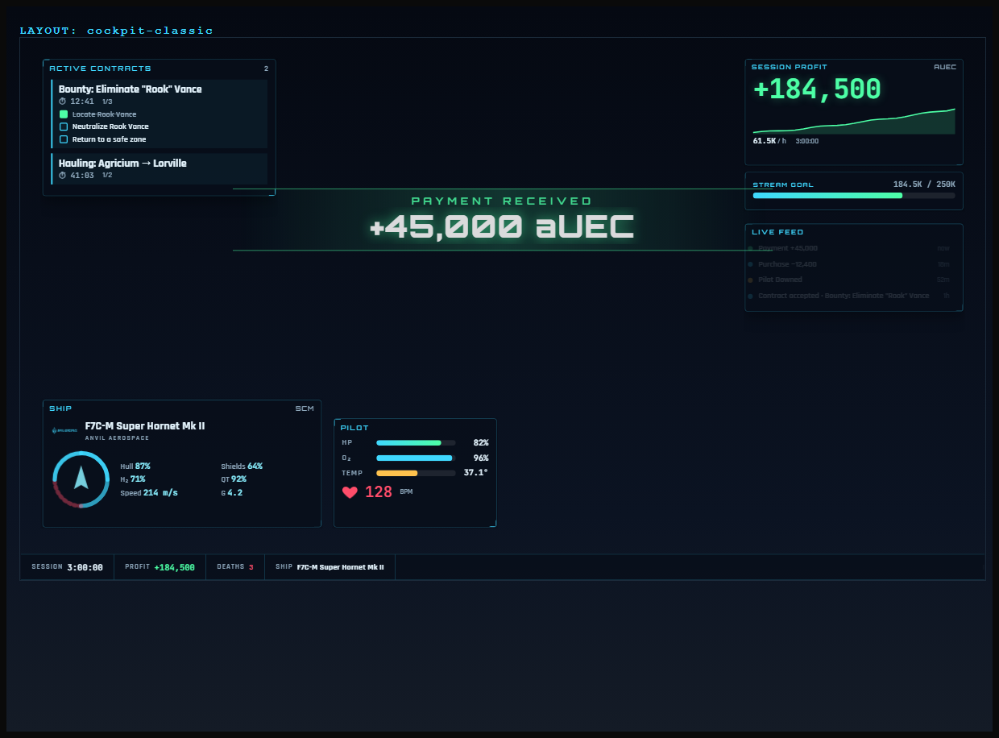

# StatsCitizen

**Companion local y open source para Star Citizen: HUD de telemetría en vivo, estadísticas de piloto desde tus logs y un overlay personalizable para stream en OBS.**

[English](README.md) · [Guía del overlay para OBS](docs/obs-overlay.md) · [Arquitectura](docs/architecture.md) · [Contribuir](CONTRIBUTING.md)


<sub>Layout Cockpit Classic (la captura usa los datos demo integrados).</sub>

> ⚠️ **Versión temprana.** Hecho y probado en Windows con Star Citizen **PTU 5.0** y **LIVE 4.10**. Puede tener detalles; si algo falla, [abre un issue](../../issues).

## Qué hace

- **HUD en vivo:** lee el stream de telemetría oficial y local del juego (gRPC en `127.0.0.1`, unas 17 actualizaciones por segundo) junto con tu `Game.log`.
  - Muestra vitales, saldo de aUEC y ganancia de la sesión.
  - De la nave: casco, escudos por cara, master mode, velocidad, fuerza G, combustible, energía y armas.
  - El HUD cambia según si vas a pie, en EVA, de piloto, de artillero o en vehículo terrestre.
  - La app toma el tema del fabricante de tu nave.
- **Overlay para OBS:** se agrega como **fuente de navegador** y se actualiza en vivo.
  - **12 widgets:** contratos activos con sus objetivos reales, ganancia, meta del stream, vitales, nave, vuelo, muertes, feed, barra inferior, ubicación con retraso, resumen final y animación de arranque.
  - **Momentos animados:** pagos, K.I.A., misil fijado, saltos cuánticos, cambio de nave, récords y meta alcanzada.
  - **Dos formas de usarlo:** un layout completo a la resolución de tu canvas, o una fuente por widget. Cada widget es responsivo y se vuelve barra, tarjeta o columna según el tamaño.
  - **Editor visual:** arrastras y redimensionas (Shift en una esquina conserva la forma). Cada widget tiene su estilo (panel, minimalista o solo texto), fuente, tamaño, grosor y colores, y puedes usar los colores de la marca de tu nave.
  - **Idioma para tus viewers:** inglés o español.
- **Historial desde tus logs:** tiempo de juego, naves, compras, colisiones, rutas cuánticas y bitácora de misiones.
- **Herramientas:** limpieza de la caché de shaders y respaldo en un clic.

## Privacidad
- **Todo es local:** sin cuentas, sin enviar datos a nadie y sin leer la memoria del juego.
- **El servidor del overlay es de solo lectura** y escucha solo en `127.0.0.1`. El acceso desde tu red (setup de 2 PCs) es opcional y lleva llave de acceso.
- **Contra stream sniping:** el saldo total va oculto y la ubicación va apagada o con retraso por defecto.

## Cómo empezar
```bash
npm install
npm run dev      # desarrollo
npm run build    # instalador en src-tauri/target/release/bundle/nsis/
```
Requisitos: Windows 10 u 11, Node.js 20 o más nuevo, Rust estable y los [prerrequisitos de Tauri 2](https://v2.tauri.app/start/prerequisites/).

1. **Telemetría:** en **Live HUD** usa **Enable telemetry**. Configura `user.cfg` (con respaldo `.bak`) y la variable `GRPC_CLIENT_SERVER_ENABLED`. Después reinicia el juego.
2. **Overlay:** en **Stream Overlay** enciende el servidor y copia la URL. En OBS agrega **Fuentes → + → Navegador** con el tamaño que te indica el editor.

Guía completa: [docs/obs-overlay.md](docs/obs-overlay.md).

## Aviso
Proyecto de fans **no oficial y sin relación con Cloud Imperium Games**. Star Citizen® es marca de Cloud Imperium Rights LLC. Los logos de fabricantes son © Cloud Imperium Rights LLC y se usan bajo sus [términos de contenido de fans](https://robertsspaceindustries.com/fankit).

## Licencia
[MIT](LICENSE).
