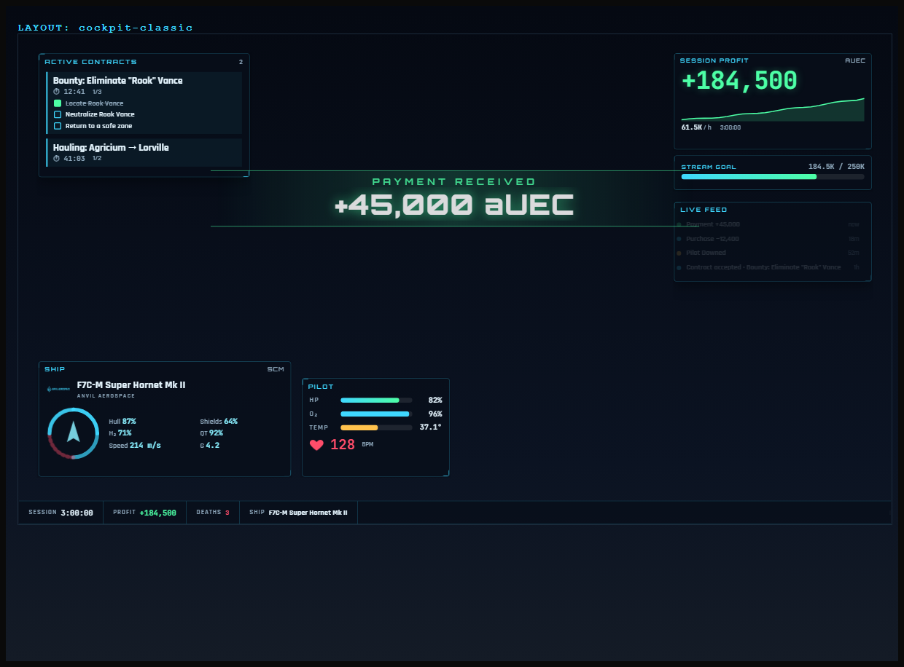
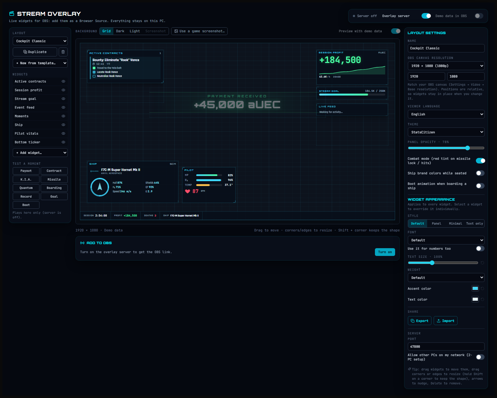
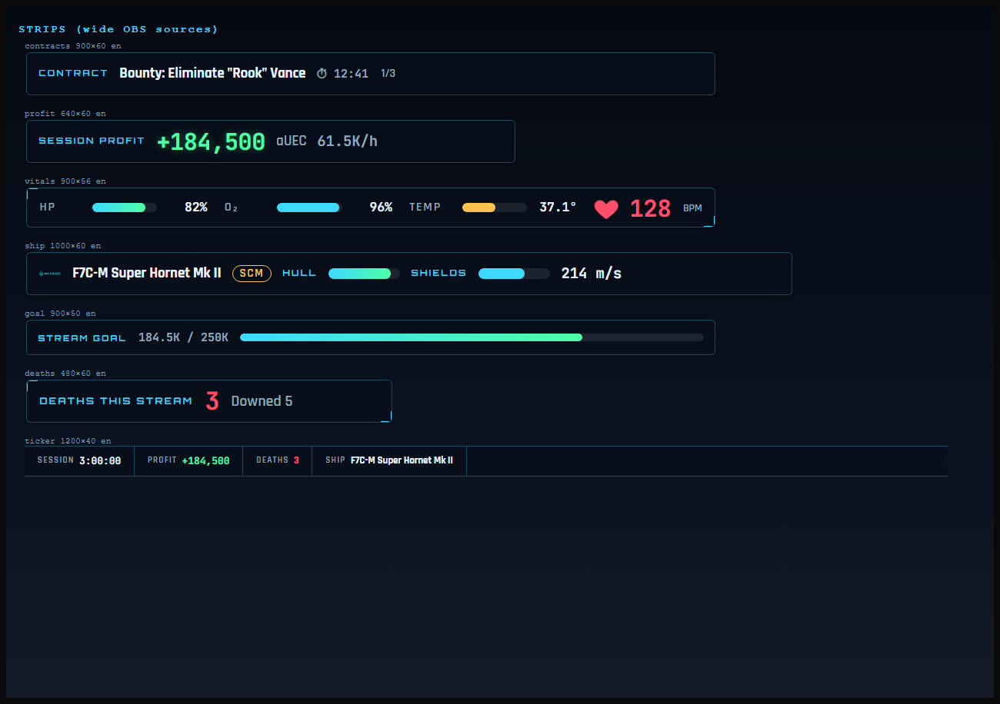
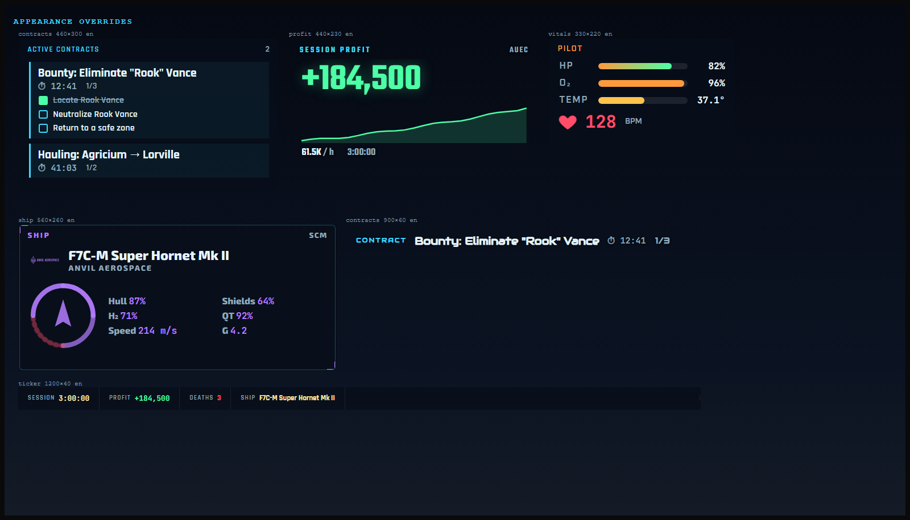

# StatsCitizen

**A local, open-source Star Citizen companion: live telemetry HUD, pilot stats from your logs, and a customizable stream overlay for OBS.**

[Español](README.es.md) · [OBS overlay guide](docs/obs-overlay.md) · [Architecture](docs/architecture.md) · [Contributing](CONTRIBUTING.md)


<sub>Cockpit Classic overlay layout (screenshot uses the built-in demo data).</sub>

> ⚠️ **Early release.** Built and tested on Windows with Star Citizen **PTU 5.0** and **LIVE 4.10**. Expect rough edges, and please [open an issue](../../issues) when something breaks.

---

## Features

### 📡 Live telemetry HUD
StatsCitizen reads the game's **official local telemetry stream**: gRPC on `127.0.0.1`, about 17 updates per second. It combines that with your `Game.log`.

- **Pilot:** health, O₂, body temperature, heart rate, hazards, aUEC balance and session profit.
- **Ship:**
  - hull and shields per face (PTU 5.0)
  - master mode, speed, G-force, altitude, fuel, power and annunciators
  - weapons and countermeasures
- **Adapts to what you're doing:** on foot, EVA, pilot, gunner and ground vehicle each get their own HUD.
- **Manufacturer OS:** the app takes on your ship maker's branding, with a boot splash and optional sounds.
- **Adaptive layout:** reorder, hide or widen modules; the HUD reflows to any monitor (vertical included) without leaving gaps, and lists like the live feed stretch to fill the space. There's also a compact mode for a second monitor.

### 🎥 Stream overlay for OBS
Add it to OBS as a **Browser Source**. It updates live, with no refreshing.

- **12 widgets:**
  - active contracts with their real objectives as the game shows them
  - session profit with a sparkline and aUEC per hour
  - stream goal, pilot vitals, ship, flight, death counter
  - event feed, bottom ticker, location with a delay
  - an end-of-stream debrief
  - a ship boot animation
- **Moments:** big animated banners for payouts, K.I.A., missile lock, quantum jumps, boarding a ship, speed records and reaching the stream goal.
- **Two ways to use it:**
  - one source for a whole layout, at your OBS canvas resolution (1080p, 1440p, 4K, vertical…)
  - one source per widget; every widget is responsive and turns into a strip, card or column depending on the size you give it
- **Visual editor:**
  - drag and resize widgets (hold Shift on a corner to keep the shape)
  - five templates and five themes, plus ship-brand colors
  - per-widget style (panel, minimal or text only), font, size, weight and colors
- **Viewer language:** English or Spanish.

| Editor | Responsive strips | Per-widget appearance |
|---|---|---|
|  |  |  |

### 🪪 Pilot history from your logs
- **Pilot dossier:** playtime, sessions and patches.
- **Flight operations:** time spent in each ship.
- **Financial ledger:** purchases.
- **Black box:** fatal collisions.
- **Quantum routes.**
- **Mission logbook:** contracts and objectives.
- **Coverage:** scans all of your `logbackups`, with a per-file cache so rescans are fast.

### 🧰 Verse toolkit
- **Shader cache cleanup:** clears only the shader cache.
- **One-click backup:** backs up `actionmaps.xml`, character files, power presets and `user.cfg`.

---

## Privacy and safety

- **100% local.** No accounts, no telemetry, and no network calls to third parties. The overlay fonts ship with the app.
- **No memory reading and no injection.** StatsCitizen only reads two things: the game's local gRPC telemetry stream, which you opt into, and log files on disk.
- **Your config is respected.** Telemetry setup appends only the keys it needs to `user.cfg` and keeps a `.bak` backup.
- **The overlay server is read-only.** It listens on `127.0.0.1` by default and can't trigger game actions or read files. Sharing it with your LAN, for a 2-PC stream setup, is opt-in and protected by an access key.
- **Stream-sniping protection:** your total balance is hidden and location is off or delayed by default.

## Getting started

### Download
Grab the installer from **[Releases](https://github.com/gerardomange/StatsCitizen/releases/latest)** (`StatsCitizen_x.y.z_x64-setup.exe`, about 3 MB). A portable `.exe` is attached to each release too. The installer isn't code-signed yet: if SmartScreen warns you, click **More info → Run anyway**, or build it yourself with the steps below.

### Requirements
- **Windows 10 or 11** with WebView2. It ships with Windows 11.
- **Star Citizen** LIVE or PTU.
- **To build from source:**
  - Node.js 20 or newer
  - Rust (stable)
  - the [Tauri 2 prerequisites](https://v2.tauri.app/start/prerequisites/), meaning the MSVC build tools

### Build from source
```bash
git clone https://github.com/gerardomange/StatsCitizen.git
cd StatsCitizen
npm install
npm run dev      # development (hot reload)
npm run build    # installer in src-tauri/target/release/bundle/nsis/
```

### Enable the game's telemetry
1. Open **Live HUD** and click **Enable telemetry**. The app then:
   - adds the `grpc.client.server.*` and `server.game.telemetry.*` keys to `user.cfg` for each channel it finds (backup included)
   - sets the user environment variable `GRPC_CLIENT_SERVER_ENABLED=true`
2. Restart Star Citizen. The HUD connects automatically when the game is running.

Without telemetry the app still works: history, contracts, objectives and zones all come from `Game.log`.

### Use the overlay in OBS
1. Open **Stream Overlay** in the sidebar and turn on **Overlay server**.
2. Click **Copy layout URL**. In OBS, go to **Sources → + → Browser**, paste the URL and set the size the editor shows (your canvas resolution).
3. Turn on **Demo data in OBS** to arrange everything without playing.

Full guide: [docs/obs-overlay.md](docs/obs-overlay.md).

## Tech stack

| Layer | Tech |
|---|---|
| Backend | Rust, Tauri 2, tokio, tonic / prost-reflect (gRPC with descriptors read from the game binary), axum (overlay server, SSE) |
| Frontend | React 18, Vite 6, TypeScript, Tailwind CSS, Framer Motion |
| Overlay | Separate Vite entry (`overlay.html`, ~85 KB gzip) served locally to OBS |

## Roadmap
- **Session recorder:** exact time per ship, the aUEC curve and kills/deaths saved per session.
- **obs-websocket integration:** automatic scene switching, for example on death or at the end of a session.
- **Signed release installers** on GitHub Releases.
- **More languages:** translations welcome. See [CONTRIBUTING.md](CONTRIBUTING.md).

## Disclaimer
StatsCitizen is an unofficial fan project and is **not affiliated with or endorsed by Cloud Imperium Games**. Star Citizen®, Roberts Space Industries® and Cloud Imperium® are trademarks of Cloud Imperium Rights LLC. Manufacturer logos are © Cloud Imperium Rights LLC and are used under the [fan content terms](https://robertsspaceindustries.com/fankit) (see [NOTICE](NOTICE)).

## License
[MIT](LICENSE). The code is free to use, modify and share. The CIG artwork mentioned above is excluded.
