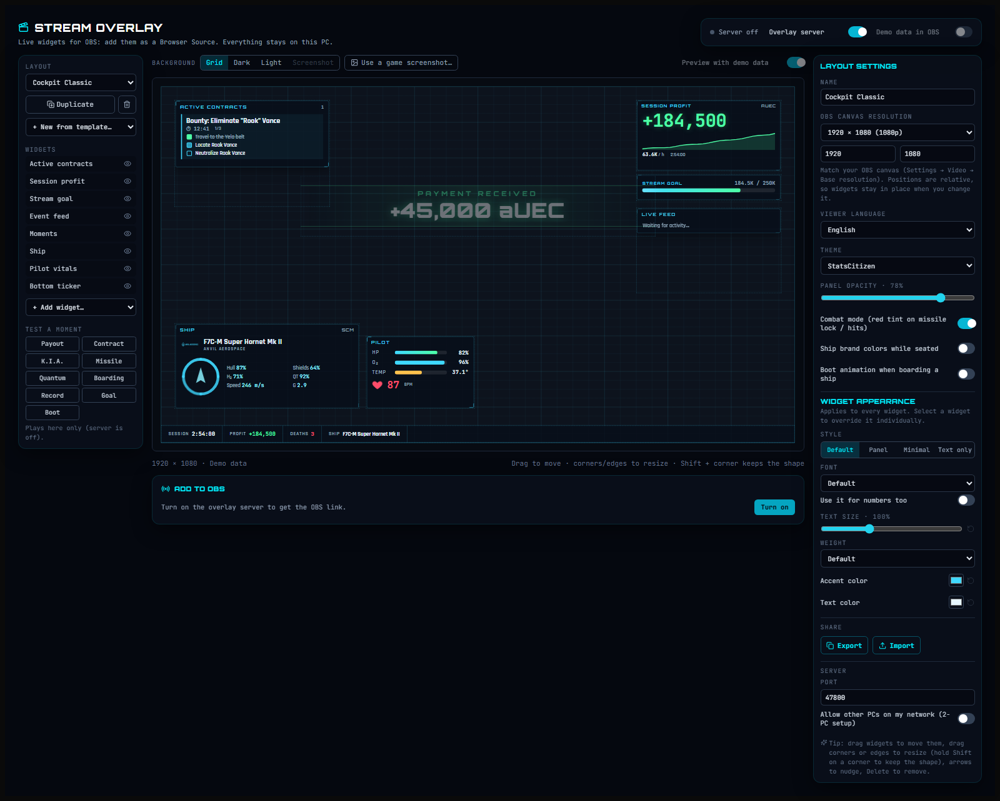
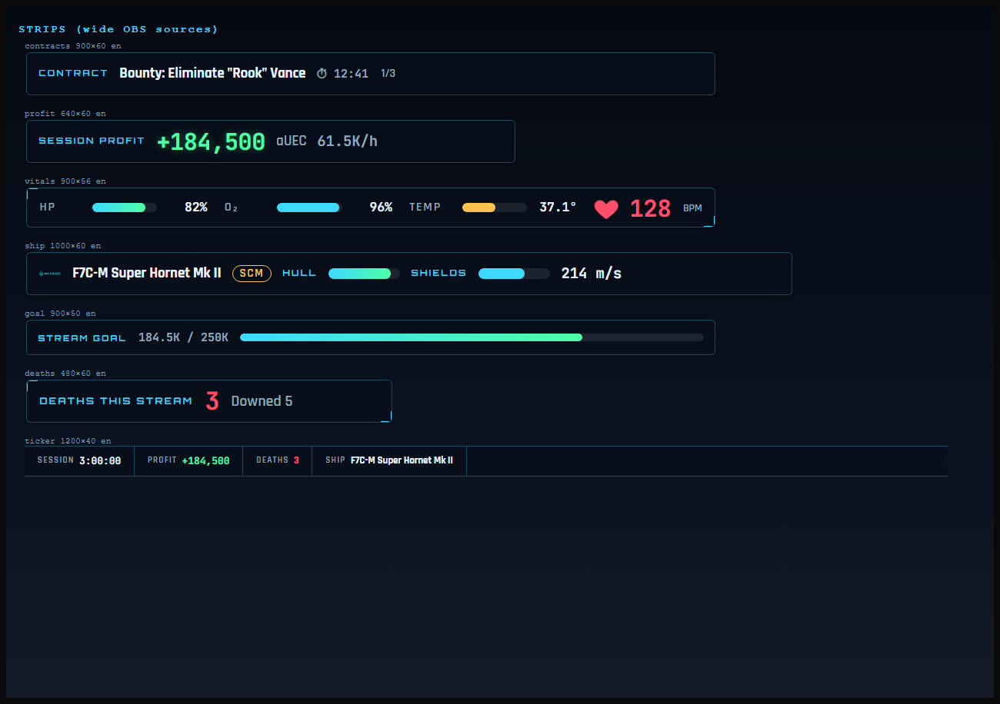
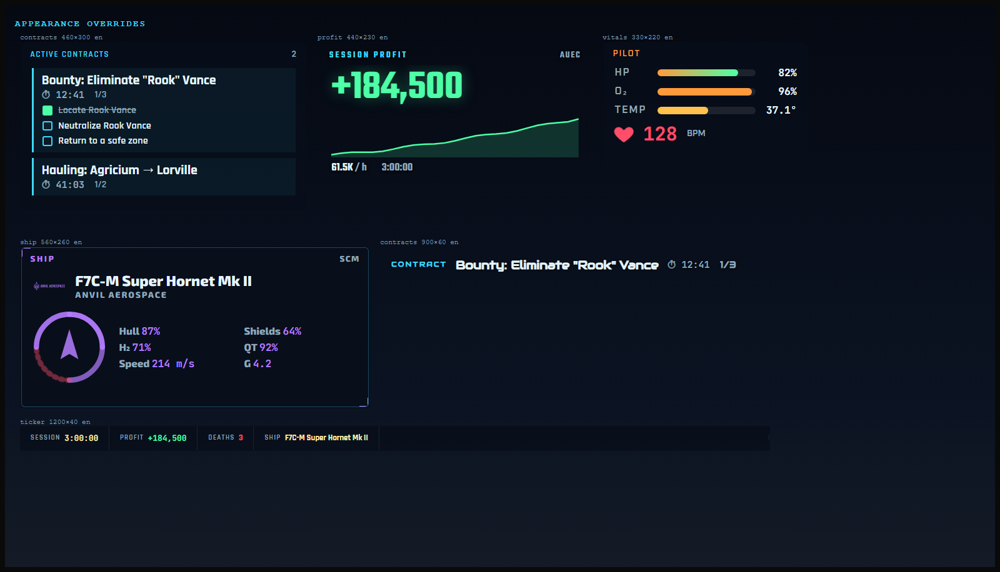

# Stream overlay for OBS

StatsCitizen runs a small local web server that OBS loads as a **Browser Source**. The overlay updates live as you play, and changes you make in the editor show up in OBS within a fraction of a second, with no refreshing.



## Quick start

1. Open **Stream Overlay** in the StatsCitizen sidebar.
2. Turn on **Overlay server**. It listens on `http://127.0.0.1:47800`; if that port is busy it uses the next free one.
3. Pick a layout (or start from a template) and click **Copy layout URL**.
4. In OBS go to **Sources → + → Browser**:
   - **URL:** paste it.
   - **Width / Height:** the size shown under the URL. It's the layout's canvas resolution.
   - Leave **Shutdown source when not visible** *off* so no moment is missed.
   - If you enabled widget sounds, turn on **Control audio via OBS**.
5. To arrange things without playing, turn on **Demo data in OBS**, and use **Test a moment** to fire banners.

If StatsCitizen is closed, the overlay stays fully transparent. It reconnects on its own when the app comes back.

## Two ways to use it

### A) Whole layout, one source
- **Canvas resolution:** every layout has one, matching your OBS canvas (Settings → Video → Base resolution). Presets are 1080p, 1440p, 4K, 720p, vertical 1080×1920 and ultrawide; you can also type any size.
- **Relative positions:** widgets are stored as fractions of the canvas, so changing the resolution keeps them in place.
- **Mismatched source size:** if the OBS source size doesn't match the canvas, the overlay scales to fit (letterboxed) instead of being cut off.

### B) One source per widget
- **URL:** select a widget in the editor and click **Copy URL**. It looks like `/overlay/<layout>/<widget>`. You can also use the widget type, e.g. `/overlay/minimal/profit`.
- **Responsive:** the widget fills whatever size you give the source in OBS and adapts:
  - wide → **strip** (one line)
  - roughly square → **card**
  - tall → **column**



## Widgets

| Widget | What it shows | Notable options |
|---|---|---|
| Active contracts | Contract name, timer and the objectives the game is showing right now. Completed ones stay for 1 minute, then go away. | max contracts, keep completed objectives, **shrink to content** (grow from top or bottom) |
| Session profit | aUEC earned this session, sparkline, aUEC/hour | title, show total balance (off by default) |
| Stream goal | Progress bar toward an aUEC target | target, title |
| Pilot vitals | HP, O₂, temperature and a heartbeat that beats at your real BPM | each field on/off |
| Ship | Manufacturer logo, shields per face, hull, H₂/QT, speed, G | shield hologram |
| Flight | Speed, G, altitude, heading | — |
| Moments | Big banners: payout, contract complete or failed, K.I.A., downed, missile lock, shields critical, quantum jump, boarding, speed record, goal reached | each kind on/off, minimum payout, show destination, sound |
| Death counter | Deaths and downs this session | title |
| Bottom ticker | Session time, profit, deaths, ship, zone, scrolling events | custom message, zone + delay |
| Event feed | Latest payments, purchases, contracts, objectives | count, show locations, shrink to content |
| Location | Current zone, **delayed** against stream sniping | delay (minutes) |
| Mission debrief | End-of-stream summary scene | title |
| Ship boot | The manufacturer boot splash when you board a ship; invisible otherwise | sound |

**Visible when…** Each widget can also be shown only in certain situations: always, game connected, seated in a ship, on foot, has an active contract, or in combat. When the condition stops being true, the widget fades out.

## Look and feel

- **Themes:** StatsCitizen, Ship manufacturer (auto), mobiGlas, Minimal, Retro MFD.
- **Ship brand colors while seated:** tints every widget with your ship maker's colors, on top of any theme.
- **Combat mode:** red tint and pulsing frame on missile lock, hits or critical shields.
- **Widget appearance:** set it for the whole layout, then override individual widgets.
  - **Style:** Panel, Minimal or Text only.
  - **Font:** seven are bundled (Rajdhani, Orbitron, Oxanium, Exo 2, Teko, Audiowide, JetBrains Mono). You can also pick a Windows font or type the name of any installed font. If OBS runs on another PC, that font must be installed there too.
  - **Text size, weight, accent color and text color.**
- **Viewer language:** English or Spanish, set per layout.



## Editor tips

| Action | How |
|---|---|
| Move | Drag the widget |
| Resize | Drag a corner or an edge |
| Resize keeping the shape | **Shift** + drag a corner |
| Nudge | Arrow keys (Shift = 10×) |
| Remove | Delete |
| Background | Grid / Dark / Light, or **Use a game screenshot…** to arrange over a real frame. The background is only shown in the editor. |
| Share a layout | **Export** copies its JSON; **Import** pastes one |

## Two-PC streaming

Enable **Allow other PCs on my network**. The editor then shows a LAN URL with an access key (`?k=…`). Keep that key off your stream; you can generate a new one at any time.

## Chat bots

`GET http://127.0.0.1:47800/api/state.json` returns a small read-only summary that Streamer.bot or any chat bot can use for commands like `!profit`, `!deaths` or `!contract`:

```json
{
  "connected": true,
  "uecDelta": 184500,
  "deaths": 3,
  "downed": 5,
  "maxSpeed": 1284,
  "ship": "F7C-M Super Hornet Mk II",
  "activeContracts": [{ "name": "New Opportunity - Ambush Strike", "acceptedAt": "2026-11-22T07:54:25.899Z" }],
  "completedContracts": 7
}
```

## Troubleshooting

| Problem | Fix |
|---|---|
| OBS shows nothing | Check that the overlay server is on and the app is running. Open the URL in a normal browser to test. |
| Shows nothing with the game running | Check **Live HUD**: telemetry has to be enabled and the game restarted. Contracts and objectives work from `Game.log` even without telemetry. |
| Wrong size or cut off | Set the Browser Source width and height to the layout's canvas resolution, or use per-widget sources. |
| A contract's reward is missing | The log doesn't record payouts. The amount comes from the aUEC balance change, so it needs telemetry. |
